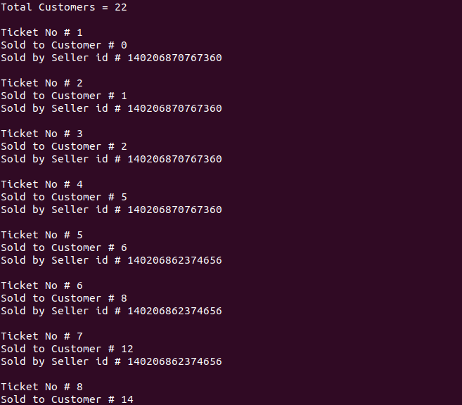

<h1 align="center">Ticket Selling Problem Using Mutex</h1>

### Description
A multithreaded C++ ticket-allocation simulation with mutex-protected shared state.

### Manual
1) Use the following command to `Compile the code`:
    ```
    g++ -pthread -o a.out main.cpp
    ```
    
2) Use following commands to `Run the Code`:
    ```
    ./a.out
    ```
    
### Working Screenshot
<div align="center">
  
</div>
