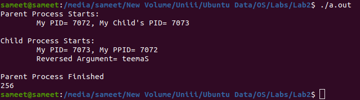

<h1 align="center">Reverse String Using Execlp</h1>

### Description
A C++ process-control implementation that delegates string reversal to a separate executable through `execlp`.

### Manual
1) Use the following commands to `Compile the Code`:
    ```
    g++ reverse_string.cpp -o reverse-string
    ```
    ```
    g++ main.cpp -o string-reversal
    ```

2) Use the following command to `Run the Code`:
    ```
    ./string-reversal
    ```
    
### Working Screenshot
<div align="center">
  
</div>
