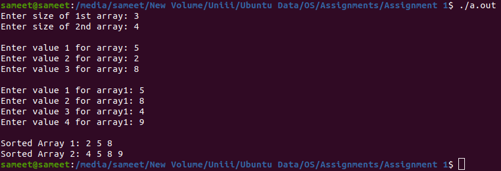

<h1 align="center">Sort Two Arrays Using Fork</h1>

### Description
A C++ process implementation that sorts two input arrays concurrently in separate child processes created with `fork`.

### Manual
1) Use the following command to `Compile the Code`:
    ```
    g++ main.cpp
    ```

2) Use the following command to `Run the Code`:
    ```
    ./a.out
    ```
    
### Working Screenshot
<div align="center">
  
</div>
