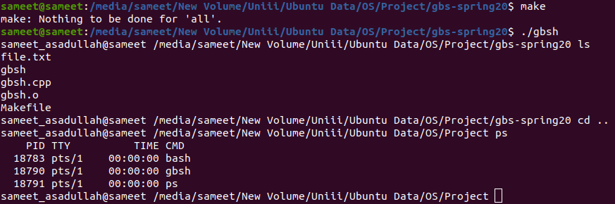

<h1 align="center">Linux gbsh Shell Implementation</h1>

### Description
A C++ Unix-style shell with command execution and core interactive behaviors modeled after established shells such as Bash and C shell.

### Commands Implemented
- ps
- ls
- cd
- top
- csh
- pwd
- man
- exit
- clear
- | (pipe)
- environ
- unsetenv
- & (ampersand)
- setenv <envar> <value> to set the environment variable <envar> to <value>
- setenv <envar> to set the environment variable <envar> to empty string
- I/O redirection (Use > for output redirection, and < for input redirection)

### Manual
1) Use the following command to `Compile the Code`:
    ```
    make
    ```

2) Use the following command to `Run the Code`:
    ```
    ./gbsh
    ```
    
### Working Screenshot
<div align="center">
  
</div>
